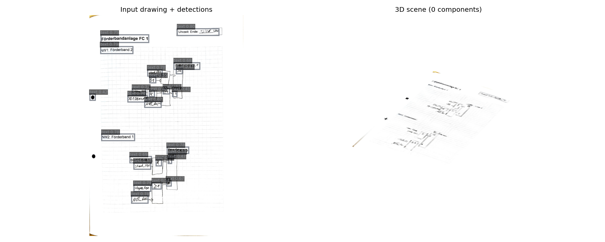
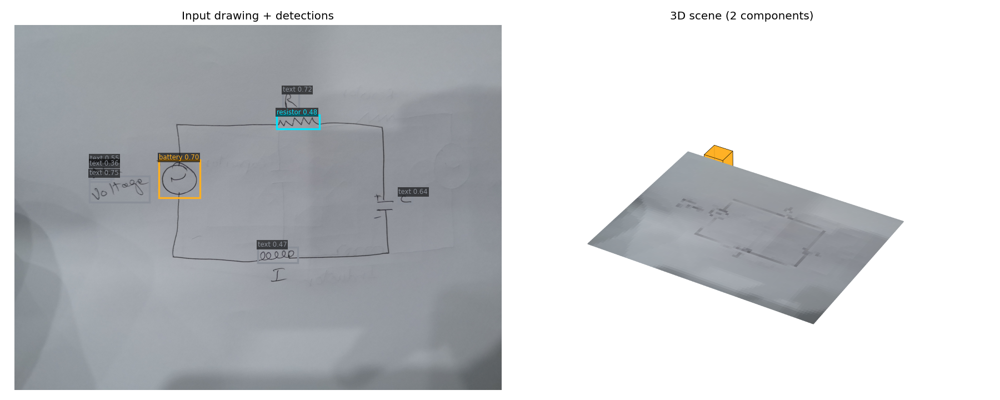
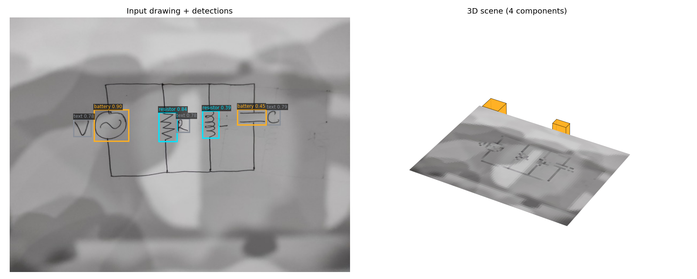
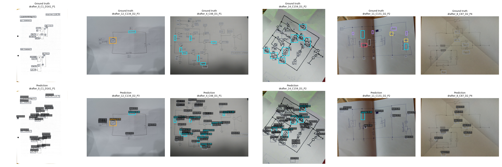
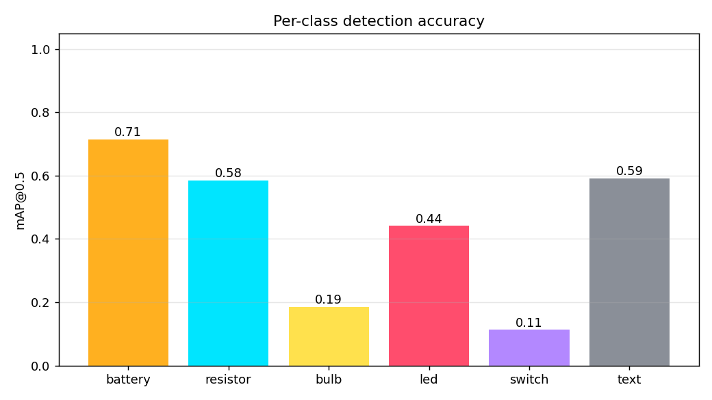
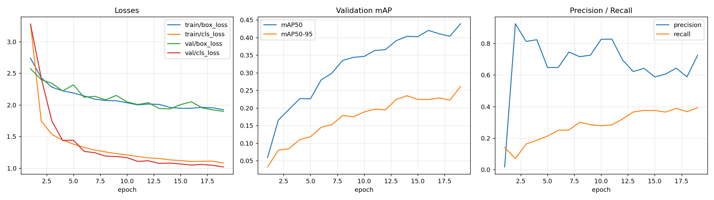
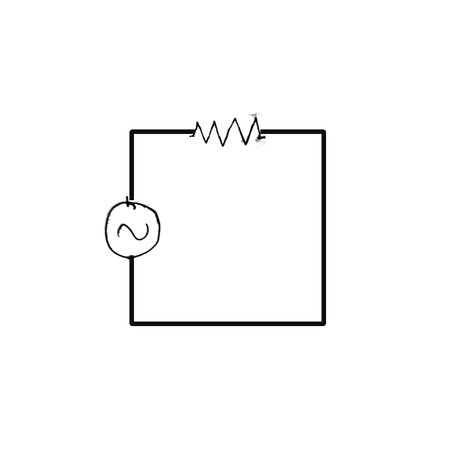
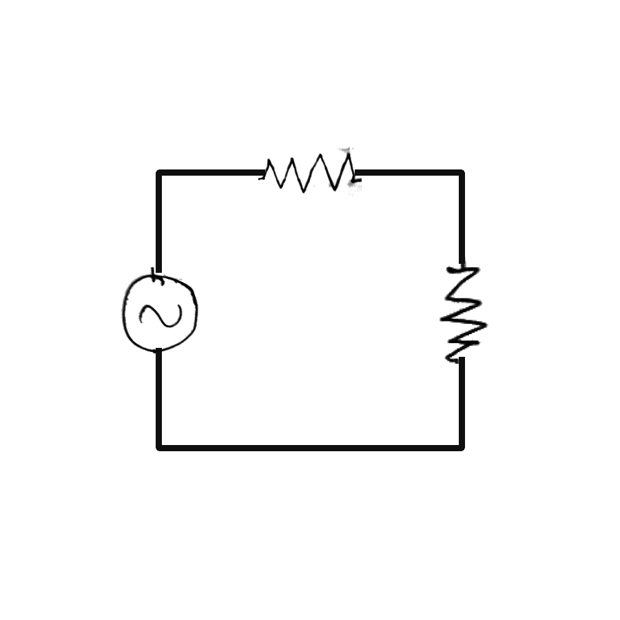
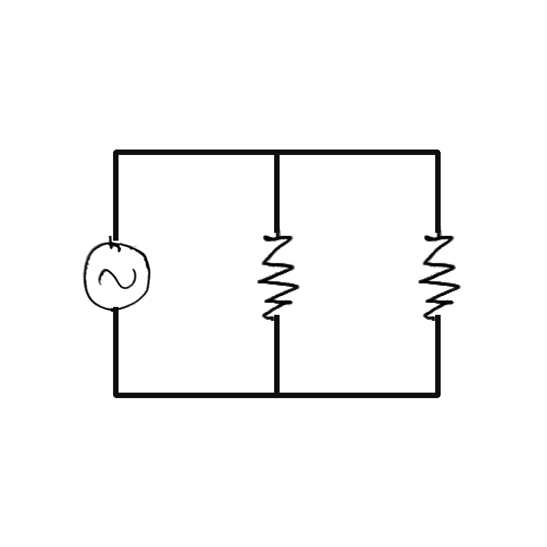
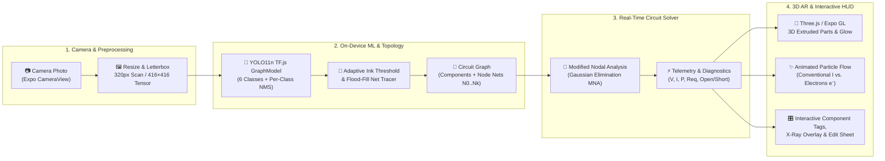

<div align="center">


# CircuitLens — Augmented Reality Circuit Scanner & 3D Simulator

**Point your phone at a hand-drawn circuit diagram on paper to detect components on-device, trace wire nets, solve real-time DC physics, and overlay an interactive 3D Augmented Reality simulation.**

[](https://expo.dev)
[](https://reactnative.dev)
[](https://threejs.org)
[](ar-circuit/training/reports/metrics.json)
[](https://www.tensorflow.org/js)
[](LICENSE)

[Visual Showcase](#-visual-showcase) •
[Architecture](#-system-architecture--pipeline) •
[Key Features](#-key-features) •
[Model Benchmarks](#-yolo11n-circuit_v2-benchmarks) •
[Quick Start](#-quick-start) •
[Training Pipeline](#-training--tfjs-export-pipeline)

</div>

---

## ⚡ Overview

**CircuitLens** turns hand-drawn electrical schematics on paper into live, interactive 3D circuit simulations directly inside **Expo Go**—with **zero cloud dependencies**:

1. **On-Device Computer Vision (`YOLO11n @ 416×416`)** — A custom-trained 6-class YOLO11n detector exported to a 9.92 MB TensorFlow.js GraphModel recognizes hand-drawn **Batteries**, **Resistors**, **Light Bulbs**, **LEDs / Diodes**, **Switches**, and **Text annotations** entirely offline on the device.
2. **Automatic Wire Net Tracing** — Adaptive local thresholding and morphological flood-fill ([`imageUtils.js`](ar-circuit/src/ml/imageUtils.js)) mask out detected symbols and text labels to trace ink lines connecting component terminals into electrical nodes (`N0`, `N1`, …).
3. **Modified Nodal Analysis (MNA) Physics Engine** — A full Gaussian-elimination nodal solver ([`solver.js`](ar-circuit/src/circuit/solver.js)) computes exact node voltages, branch currents, equivalent load resistance ($R_{\text{eq}}$), and power dissipation ($P = V \cdot I$), while detecting open circuits, short circuits, and reverse-biased LEDs.
4. **3D WebGL Augmented Reality Overlay** — Extrudes 3D procedural component meshes ([`Scene3D.js`](ar-circuit/src/ar/Scene3D.js), [`models.js`](ar-circuit/src/ar/models.js)) directly onto the paper schematic with glowing bulbs/LEDs proportional to power, animated current/electron flow particles ([`FlowPath.js`](ar-circuit/src/ar/FlowPath.js)), a Vision **X-Ray** inspection layer, and live tap-to-edit component tags.

---

## 📸 Visual Showcase

### 2D Hand-Drawn Schematic → YOLO11n Detection → 3D Extruded AR Scene

| Sample 1 — Simple Loop | Sample 2 — Multi-Component | Sample 3 — Complex Network |
| :---: | :---: | :---: |
|  |  |  |

### Validation Ground Truth vs. `circuit_v2` Model Predictions



### Per-Class Detection Accuracy & Training Curves

| Per-Class `mAP@0.5` | Loss, mAP & Precision/Recall Curves |
| :---: | :---: |
|  |  |

### Printable Sample Schematics Ready to Scan ([`sample_circuits_to_scan/`](sample_circuits_to_scan))

| Single Resistor Loop (`B1 + R1`) | Series Resistors (`B1 + R1 + R2`) | Parallel Branches (`B1 + R1 ∥ R2`) |
| :---: | :---: | :---: |
|  |  |  |

---

## 🧠 System Architecture & Pipeline



---

## ✨ Key Features

| Module | Capabilities |
| :--- | :--- |
| **🤖 On-Device YOLO11n (`416px`)** | Runs 100% locally inside Expo Go via `@tensorflow/tfjs` custom Metro asset `IOHandler` ([`detector.js`](ar-circuit/src/ml/detector.js)). Uses per-class confidence thresholds tuned for rare symbols (`bulb`, `switch`, `led`). |
| **🧵 Automatic Wire Net Tracer** | [`traceNets()`](ar-circuit/src/ml/imageUtils.js) computes local box-blurred ink thresholds, clears component interiors & handwritten text boxes, and flood-fills connected ink paths to assign node IDs to every terminal pin. |
| **📐 Modified Nodal Analysis (MNA)** | [`solveCircuit()`](ar-circuit/src/circuit/solver.js) solves arbitrary series, parallel, and bridge DC networks. Models battery internal resistance, open/closed switch states, and diode polarity/forward conduction. |
| **🧊 3D WebGL AR Scene** | [`Scene3D.js`](ar-circuit/src/ar/Scene3D.js) & [`models.js`](ar-circuit/src/ar/models.js) render 3D batteries, color-banded resistors, glowing glass filaments, translucent LEDs, animated knife switches, and particle streams scaled by branch current. |
| **🔬 Vision X-Ray & Live Editor** | Toggle **X-Ray** ([`ScanOverlay.js`](ar-circuit/src/ui/ScanOverlay.js)) to inspect raw ML bounding boxes, confidence percentages, masked `TXT` boxes, and color-coded terminal net pins (`N0`, `N1`, …). Tap any tag to change values ($V$, $\Omega$), flip polarity, toggle switches, retype misclassified parts, or undo edits. |
| **🧪 Built-In Demo Lab** | Instant interactive 3D circuits ([`demo.js`](ar-circuit/src/circuit/demo.js)) — *Simple Loop*, *Series Divide*, *Parallel Branches*, and *Switched LED* — work without camera permissions. |

---

## 📊 YOLO11n `circuit_v2` Benchmarks

We built a leak-free v2 dataset pipeline ([`make_dataset_v2.py`](ar-circuit/training/make_dataset_v2.py)) from the **CGHD (Circuit Graphs on Hand Drawings)** dataset:
- **Leak-free grouping:** Splits by `drafter + circuit` so multi-photo shots (`_P1.._P4`) of the same drawing never leak between `train` (8,320 images) and `val` (700 images).
- **Viewfinder scale matching:** Generates portrait/square crops where symbols occupy 8–28% of the frame, matching how users frame drawings inside the app's viewfinder.
- **Rare-class oversampling:** Oversamples scarce symbols (`bulb`, `switch`, `battery`, `led`) and automatically paints out partially clipped boundary symbols.

### Validation Accuracy (`v1 @ 320px` vs. `circuit_v2 @ 416px`)

| Class / Metric | Old `v1` (`YOLOv8n @ 320px`) | New `circuit_v2` (`YOLO11n @ 416px`) | Improvement |
| :--- | :---: | :---: | :---: |
| **Overall `mAP@0.5`** | `0.438` | **`0.756`** | **+72.6%** |
| **Overall `mAP@0.5:0.95`** | `0.262` | **`0.504`** | **+92.4%** |
| **Overall Precision** | `0.752` | **`0.817`** | **+8.6%** |
| **Overall Recall** | `0.385` | **`0.655`** | **+70.1%** |
| **Resistor `mAP@0.5`** | `0.584` | **`0.880`** | **+50.7%** |
| **LED / Diode `mAP@0.5`** | `0.442` | **`0.832`** | **+88.2%** |
| **Text Label `mAP@0.5`** | `0.591` | **`0.832`** | **+40.8%** |
| **Light Bulb `mAP@0.5`** | `0.186` | **`0.771`** | **+314.5%** |
| **Battery `mAP@0.5`** | `0.715` | **`0.733`** | **+2.5%** |
| **Switch `mAP@0.5`** | `0.113` | **`0.489`** | **+332.7%** |
| **Bundled TF.js Weight Size** | `11.51 MB` | **`9.92 MB`** | **-13.8% smaller** |

### End-to-End Verification on Sample Schematics ([`test-detector.mjs`](ar-circuit/scripts/test-detector.mjs))

```text
Sample circuits (YOLO11n circuit_v2 @ 416px in TensorFlow.js):
  sample1_battery_resistor.jpg       battery(0.88), resistor(0.76)
  sample2_series_2resistors.jpg      battery(0.89), resistor(0.83), resistor(0.78)
  sample3_parallel_resistors.jpg     battery(0.88), resistor(0.82), resistor(0.80)
```

---

## 🚀 Quick Start

### Prerequisites
- **Node.js** `>= 18`
- [**Expo Go**](https://expo.dev/go) installed on your iOS or Android device

### 1. Install & Launch the Mobile App

From the repository root, double-click **`start-app.bat`** (Windows) or run:

```bash
cd ar-circuit
npm install
npx expo start -c
```

Scan the QR code in your terminal with **Expo Go** (Android) or the **Camera app** (iOS).

### 2. Run Automated Solver & On-Device Detector Tests

Verify the MNA circuit physics engine and run the bundled TensorFlow.js model through the exact app post-processing pipeline in Node.js:

```bash
cd ar-circuit

# 1. Verify MNA nodal circuit solver (series, parallel, open switch)
node scripts/test-solver.mjs

# 2. Run the bundled TF.js GraphModel on validation drawings + sample_circuits_to_scan/
node scripts/test-detector.mjs
```

---

## 🛠️ Training & TF.js Export Pipeline

All training, evaluation, and TensorFlow.js conversion scripts live in [`ar-circuit/training/`](ar-circuit/training) and run locally on Windows/Linux with an NVIDIA CUDA GPU:

```bash
cd ar-circuit/training

# 1. Install PyTorch (CUDA 12.8) & training dependencies
pip install torch torchvision --index-url https://download.pytorch.org/whl/cu128
pip install -r requirements.txt

# 2. Build the leak-free, scale-matched v2 dataset (8,320 train / 700 val images)
python make_dataset_v2.py --src dataset --out dataset_v2

# 3. Train YOLO11n at 416px (or pass --resume to continue from last.pt)
python train.py --data dataset_v2/data.yaml --imgsz 416 --epochs 70 --batch 32

# 4. Generate evaluation metrics, PR/F1 curves, prediction grids & 2D->3D renders
python evaluate.py --weights runs/circuit_v2/weights/best.pt --data dataset_v2/data.yaml --imgsz 416

# 5. Export best.pt -> TensorFlow.js GraphModel & auto-wire into the Expo app
python export_app_model.py --weights runs/circuit_v2/weights/best.pt --imgsz 416
```

> [!NOTE]
> [`export_app_model.py`](ar-circuit/training/export_app_model.py) includes an automatic graph post-processor (`fix_depthwise_conv2d`) that rewrites `onnx2tf`'s grouped `Conv2D` (`[3, 3, 1, 128]`) inside YOLO11's `C2PSA` attention block into `DepthwiseConv2dNative` (`[3, 3, 128, 1]`), ensuring 100% compatibility with TensorFlow.js on React Native.

---

## 📁 Project Structure

```text
Augmented-Reality-Circuit/
├── ar-circuit/                        # Expo React Native application
│   ├── App.js                         # Main HUD, camera capture, scan lifecycle & telemetry
│   ├── metro.config.js                # Metro bundler config (.bin weight shard asset support)
│   ├── assets/
│   │   └── model/                     # Bundled YOLO11n @ 416px TF.js GraphModel (9.92 MB)
│   │       ├── model.json
│   │       ├── labels.json
│   │       └── group1-shard1of3..3of3.bin
│   ├── scripts/
│   │   ├── patch-three.js             # Postinstall patch for three.js on React Native
│   │   ├── test-detector.mjs          # Node CLI benchmark for the bundled TF.js detector
│   │   └── test-solver.mjs            # Unit tests for the MNA circuit solver
│   ├── src/
│   │   ├── ar/
│   │   │   ├── Scene3D.js             # Three.js / Expo GL 3D AR scene & camera projection
│   │   │   ├── models.js              # Procedural 3D meshes (battery, resistor, bulb, LED, switch)
│   │   │   └── FlowPath.js            # Animated current / electron particle streams along wires
│   │   ├── circuit/
│   │   │   ├── solver.js              # Modified Nodal Analysis (MNA) DC circuit solver
│   │   │   ├── topology.js            # Terminal extraction, wire routing & unit formatting
│   │   │   └── demo.js                # Pre-built interactive 3D demo circuits
│   │   ├── ml/
│   │   │   ├── detector.js            # On-device TF.js model loader & custom Metro IOHandler
│   │   │   ├── yolo.js                # Letterbox preprocessing, YOLO decoding & per-class NMS
│   │   │   ├── scanner.js             # End-to-end photo -> detections -> wire nets pipeline
│   │   │   ├── imageUtils.js          # JPEG decoder, adaptive threshold & flood-fill net tracer
│   │   │   ├── classMap.js            # Dataset label -> simulator component type mapping
│   │   │   └── modelRegistry.js       # Auto-generated Metro asset registry (imgsz: 416)
│   │   └── ui/
│   │       ├── ComponentTags.js       # Floating component tags & interactive EditSheet modal
│   │       ├── ScanOverlay.js         # Vision X-Ray bounding box/net pin overlay & Guide modal
│   │       └── theme.js               # Dark oscilloscope neon color palette
│   └── training/                      # Python GPU training, evaluation & TF.js export pipeline
│       ├── make_dataset_v2.py         # Leak-free split, scale-matched crops & rare-class oversampling
│       ├── train.py                   # YOLO11n 416px trainer (RTX 50-series / CUDA 12.8 ready)
│       ├── evaluate.py                # Generates metrics.json, training curves & 2D->3D plots
│       ├── export_app_model.py        # 1-command PyTorch .pt -> TF.js GraphModel + DepthwiseConv fix
│       └── reports/                   # Evaluation plots & metrics.json
├── sample_circuits_to_scan/           # Printable hand-drawn test schematics (JPG & PNG)
├── start-app.bat                      # One-click Windows launcher for Expo Metro server
└── LICENSE                            # MIT License
```

---

## 📄 License

Distributed under the **MIT License**. See [`LICENSE`](LICENSE) for full details.
